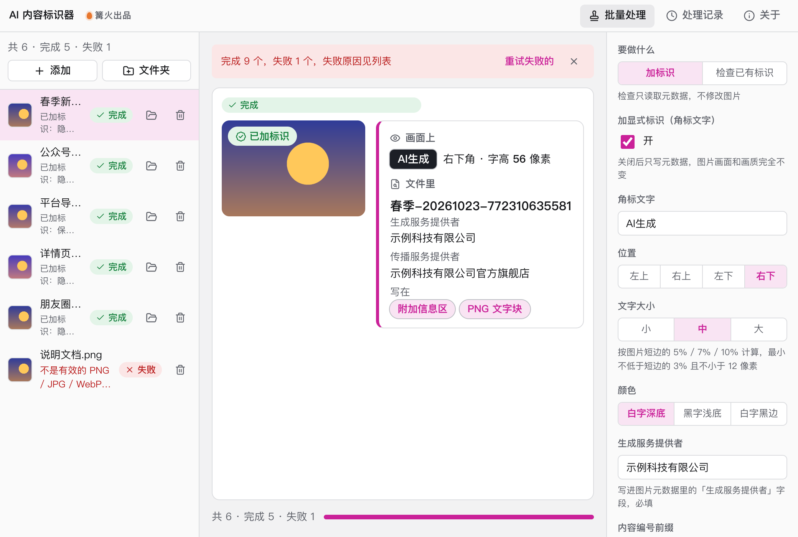

# AI 内容标识器

> 篝火出品 · 收录于篝火 App 应用区

按《人工智能生成合成内容标识办法》一键加显式标识和元数据



## 下载

到 [Releases](https://github.com/campfire-code/ai-content-labeler/releases/latest) 下载对应安装包：

| 电脑 | 文件 |
|---|---|
| Windows 10 / 11 | `ai-content-labeler_版本号_windows-x64-setup.exe` |
| Mac（Apple 芯片） | `ai-content-labeler_版本号_mac-arm64.dmg` |
| Mac（Intel 芯片） | `ai-content-labeler_版本号_mac-x64.dmg` |

第一次打开：
- **Windows**：如果弹出「Windows 已保护你的电脑」，点「更多信息」→「仍要运行」。
- **Mac**：如果提示「无法验证开发者」，打开「系统设置 → 隐私与安全性」，在下方点「仍要打开」。

## 怎么用

**加标识**
1. 把 AI 生成的图片拖进窗口（可多张或整个文件夹），支持 PNG、JPG、WebP。
2. 「要做什么」选「加标识」。
3. 显式标识：默认在右下角加「AI生成」角标，可改文字（不超过 20 个字）、位置（四个角）、大小、颜色。字高按图片短边的 5% / 7% / 10% 计算，不会低于短边的 3%，也不会小于 12 像素；图片太小放不下时会提示，不会硬塞一个看不清的角标。关掉「加显式标识」则只写元数据，画面一个像素都不变。
4. 隐式标识：填「生成服务提供者」（必填，生成这张图的 AI 服务提供者名称或编码），可选填「内容编号前缀」和「传播服务提供者」。
5. 点「开始处理」，结果保存到「保存到」文件夹（默认 `下载/AI 内容标识器`），文件名与原图相同；保存位置不能是原图所在文件夹，以免覆盖原图。
6. 处理完，每张图的结果里会有一份「标识档案」：左边是成品图，右边写明角标文字、位置、字高，以及写进文件的内容编号、生成服务提供者和写入位置。还可以点「导出清单（CSV）」，得到每张图的内容编号、生成方等，便于留存。

**检查已有标识**：「要做什么」选「检查已有标识」，拖入图片后开始处理，列表里显示每张图是否带 AIGC 隐式标识、生成方和内容编号，不修改图片。可导出「AI生成标识检查报告.csv」。注意：只能检查元数据里的隐式标识，看不出画面上有没有文字角标，也检测不了数字水印。

**写入了什么**

| 格式 | 写入位置 |
|---|---|
| PNG | ① `iTXt` 块，关键字 `XML:com.adobe.xmp`，内容是 XMP；② `tEXt` 块，关键字 `AIGC`，内容是同样的 JSON（中文写成 `\uXXXX` 转义） |
| JPG | `APP1` 段里的 XMP（标准 XMP 头 `http://ns.adobe.com/xap/1.0/`）；原有的 EXIF 等段保留 |
| WebP | 暂不支持写 WebP 元数据，转存为 PNG 后按 PNG 写入 |

XMP 里使用命名空间 `http://www.tc260.org.cn/ns/AIGC/1.0/`（前缀 `TC260`），元素 `TC260:AIGC` 的内容是 JSON：

```json
{"Label":"1","ContentProducer":"生成服务提供者","ProduceID":"内容编号","ReservedCode1":"","ContentPropagator":"传播服务提供者","PropagateID":"","ReservedCode2":""}
```

- 这个命名空间和七个字段名，是我们从多个开源实现以及国内 AI 平台实际导出图片里看到的写法，这些实现称其依据 GB 45438-2025 的附录。**我们没有拿到标准原文逐字核对**，字段含义和取值（例如 `Label` 填 `1`）请以标准原文为准；如有出入欢迎提 issue。
- `ProduceID`（内容编号）= 前缀 + 处理日期 + 原图内容 SHA-256 摘要的前 12 位，同一张图当天重复处理编号不变。
- `ReservedCode1` / `ReservedCode2`（预留字段，一些平台用来放签名）和 `PropagateID` 留空。
- 「图片里已有隐式标识时」默认「保留原有」：AI 平台导出的图片往往已经带有平台写入的标识，保留它可以留下真实的生成方信息；只加角标，元数据沿用原来的。选「用新填的替换」才会改写。

**法规说明**：《人工智能生成合成内容标识办法》由国家互联网信息办公室、工业和信息化部、公安部、国家广播电视总局联合发布，2025 年 9 月 1 日起施行，配套强制性国家标准 GB 45438-2025《网络安全技术 人工智能生成合成内容标识方法》。办法把标识分为显式标识（用户能直接看到的文字、声音、图形等）和隐式标识（写在文件数据里、用户不易察觉的标识）。具体义务、适用对象和格式要求请以官方原文为准，本工具不构成法律意见。

**暂不支持**：视频、音频、文本文件的标识；WebP 原格式写入；数字水印。

全部在本机完成，不联网、不上传。

## 验收用例

| 操作 | 应得到 |
|---|---|
| 「加标识」，「生成服务提供者」填 `示例科技有限公司`，拖入 `samples/AI海报.png`（1200×800），开始处理 | 输出 `AI海报.png`，右下角有白字深底「AI生成」，字高 56 像素；结果显示「已加标识：隐式标识 + 角标「AI生成」（右下，字高 56 像素） · 编号 20xxxxxx-…」 |
| 把上一步输出的 `AI海报.png` 用「检查已有标识」处理 | 显示「有隐式标识：生成方 示例科技有限公司，内容编号 …（位置：XMP、PNG 文字块 AIGC）」 |
| 「加标识」，关掉「加显式标识」，拖入 `samples/AI插画.jpg` | 输出 `AI插画.jpg` 画面与原图完全一样，文件略大几百字节；用「检查已有标识」能读到 XMP 里的标识 |
| 「加标识」（生成服务提供者随便填），拖入 `samples/平台已标识.png` | 结果显示「已加标识：保留原有隐式标识 + 角标… · 原生成方 示例AI平台」，内容编号仍是 `DEMO-0001` |
| 同上，但「图片里已有隐式标识时」选「用新填的替换」 | 生成方改为新填的名称，内容编号变成新编号 |
| 「检查已有标识」，拖入 `samples/` 里全部 4 个文件，处理后点「导出清单（CSV）」 | `平台已标识.png` 显示有标识（生成方 示例AI平台，编号 DEMO-0001）；`AI海报.png`、`AI插画.jpg` 显示「没有找到 AI 生成隐式标识」；`不是图片.png` 失败：「不是有效的 PNG / JPG / WebP 图片，可能已损坏或扩展名不对」；保存文件夹里出现 `AI生成标识检查报告.csv`，Excel 打开不乱码 |
| 「加标识」，「生成服务提供者」留空，拖入 `samples/AI海报.png` | 失败：「请先在「生成服务提供者」里填写生成这张图的 AI 服务提供者名称或编码」 |

开发自检：`pnpm dev` 后打开 `http://localhost:1420/selftest.html`，每行都应是 PASS（真实画布下加角标、写元数据、读回、输出仍可解码、只写元数据时像素不变、小图字高不低于 12 像素）。

## 自己编译

需要 Node.js 22、pnpm、Rust。

```bash
pnpm install
pnpm test          # 单元测试
pnpm tauri dev     # 开发运行
pnpm tauri build   # 打包
```

界面框架在 `src/kit`（所有 campfire-code 工具共用），本工具的逻辑在 `src/tool`。

## 归属

本工具由**篝火**出品，是篝火 App 应用区收录的开源工具之一，由篝火（GitHub 组织 [campfire-code](https://github.com/campfire-code)）维护与更新。全部工具的目录见 [toolkit-hub](https://github.com/campfire-code/toolkit-hub)。

## 许可证

MIT，版权方为篝火（campfire-code）。
